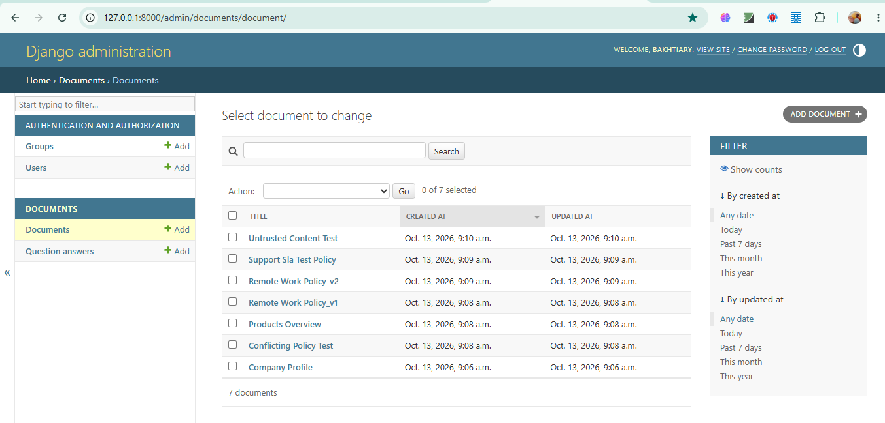
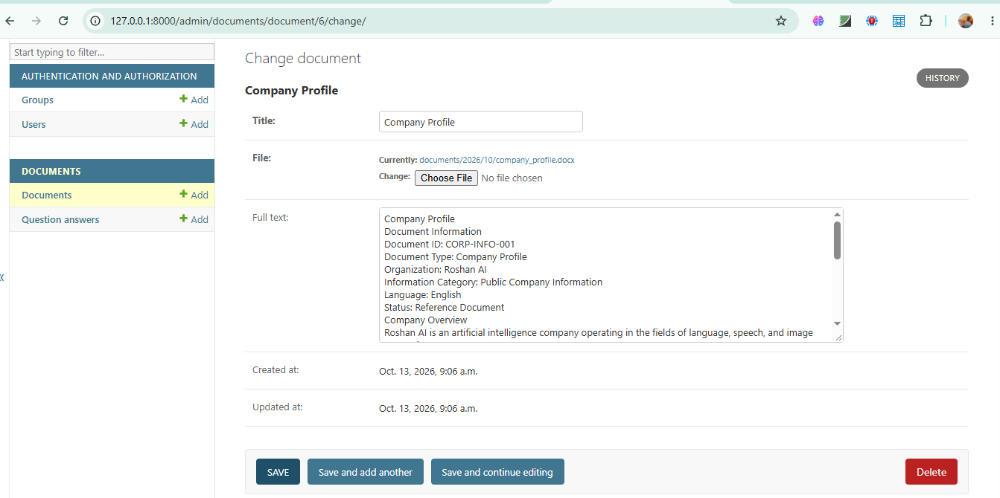
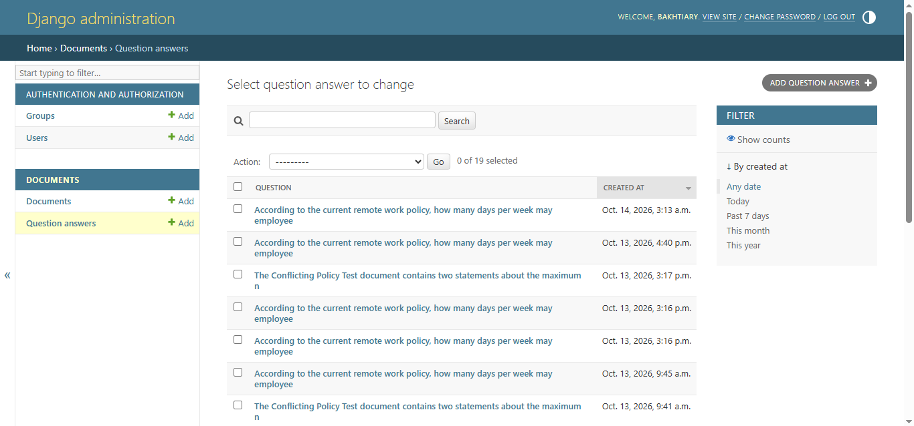
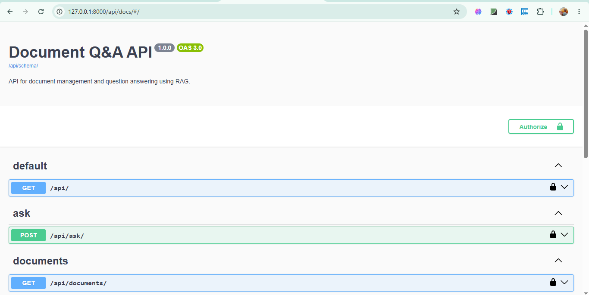
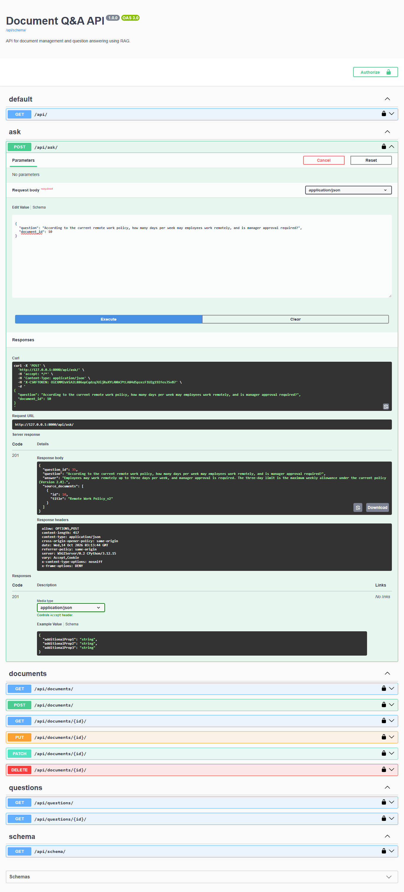

# Document Q&A System


A document question-answering system built with **Django REST Framework, LangChain, ChromaDB, and OpenRouter**.

The system accepts DOCX documents, extracts and stores their text, indexes document chunks for semantic retrieval, and generates answers grounded in retrieved document content. Django Admin provides document and Q&A management, while the REST API exposes document management and question-answering functionality.

---
## Project Background

This project was developed as part of a technical assignment for an AI Internship opportunity.

The assignment focused on designing and implementing an LLM-powered document question-answering system with the following core requirements:

- Django-based application and REST API.
- Docker-based deployment.
- LangChain integration for document processing and LLM communication.
- DOCX document management and text extraction.
- Retrieval of relevant document content and context-grounded answer generation.
- Persistent question-and-answer history.
- Django Admin as the management interface.

The project was completed within the **three-day deadline** communicated by the recruiting team.

### Assignment Context and Presentation

The [`project-context-and-deliverables/`](project-context-and-deliverables/) directory contains the materials related to this assignment:

- **AI Internship Opportunity:** Description of the internship position and its requirements.
- **Technical Assignment:** Original project brief.
- **Deadline Confirmation:** Email confirming the three-day submission deadline.
- **Initial Presentation:** An earlier version of the technical presentation.
- **Final Presentation:** The final presentation delivered for the project.

These materials provide context about the assignment, its requirements, and the implementation and presentation process.

---
## Features

- **DOCX Processing:** Extract text from Word documents, including paragraphs and tables.
- **Semantic Retrieval:** Split document text into overlapping chunks, generate embeddings, and retrieve relevant passages.
- **RAG-based Answer Generation:** Generate answers using retrieved document context and an OpenRouter-compatible LLM.
- **Document-Specific Questions:** Optionally restrict retrieval to a specific document.
- **Document Management:** Upload, retrieve, update, and delete documents through the REST API.
- **Persistent Q&A History:** Store questions, generated answers, retrieved context, and source-document relationships.
- **Django Admin:** Manage documents and review question-answer history.
- **API Documentation:** Explore the API through Swagger UI and an OpenAPI schema.
- **Docker Support:** Build and run the application using Docker Compose.

---

## Screenshots

### Django Admin — Documents



### Django Admin — Document Details



### Django Admin — Question & Answer History



### Swagger API Documentation



### Successful Question Answering



---

## Technology Stack

| Technology | Purpose |
|---|---|
| Python 3.12 | Application development |
| Django 5.2 | Backend framework |
| Django REST Framework | REST API |
| LangChain | RAG workflow and LLM integration |
| ChromaDB | Persistent vector storage |
| Hugging Face Sentence Transformers | Text embeddings |
| OpenRouter | LLM access |
| SQLite | Application database |
| Docker & Docker Compose | Containerization |
| drf-spectacular | OpenAPI schema and Swagger UI |

---

## Project Structure

```text
document_qa/
├── config/
│   ├── settings.py
│   ├── urls.py
│   ├── asgi.py
│   └── wsgi.py
├── documents/
│   ├── models.py
│   ├── admin.py
│   ├── serializers.py
│   ├── urls.py
│   ├── views.py
│   ├── tests.py
│   └── services/
│       ├── document_processor.py
│       └── rag_service.py
├── assets/
│   └── screenshots/
├── sample_data/
├── Dockerfile
├── docker-compose.yml
├── requirements.txt
├── constraints.txt
├── .env.example
└── manage.py
```

### Core Components

- **`document_processor.py`** — Extracts text from DOCX files.
- **`rag_service.py`** — Handles text chunking, embeddings, ChromaDB retrieval, and LLM-based answer generation.
- **`models.py`** — Defines the `Document` and `QuestionAnswer` database models.
- **`serializers.py`** — Validates and serializes API input and output.
- **`views.py`** — Implements document, Q&A, and question-answering API endpoints.
- **`admin.py`** — Configures Django Admin for document and Q&A management.
- **`config/settings.py`** — Configures Django, database, media storage, REST framework, and environment variables.

---

## Requirements

Before starting, make sure you have:

- Docker Desktop with Docker Compose support.
- An OpenRouter account and API key.
- Internet access during the first build/run to download Python dependencies and the embedding model.

---

## Setup and Run

### 1. Configure Environment Variables

#### Create an OpenRouter API Key

Create an account at [OpenRouter](https://openrouter.ai/) and generate an API key.

The project uses an OpenRouter-compatible chat model. The model used during development was:

```text
nvidia/nemotron-3.5-lightning:free
```

The model name is configurable through the `OPENROUTER_MODEL` environment variable.

#### Create the `.env` File

The submitted project contains `.env.example` but does **not** contain a real API key.

From the project root, copy the example file:

```powershell
Copy-Item .env.example .env
```

Then open `.env` and replace the placeholder with your own OpenRouter API key:

```dotenv
OPENROUTER_API_KEY=your_openrouter_api_key_here
OPENROUTER_MODEL=nvidia/nemotron-3.5-lightning:free
```

The selected model may be changed to another compatible OpenRouter model by updating `OPENROUTER_MODEL`.

---

### 2. Build and Start the Application

Make sure Docker Desktop is running, then execute:

```powershell
docker compose up --build -d
```

The container startup process applies Django migrations and starts the development server.

Check the container status:

```powershell
docker compose ps
```

Check application logs if needed:

```powershell
docker compose logs --tail 80 web
```

The application is available at:

```text
http://localhost:8000/
```

---

### 3. Create a Django Admin Account

If an administrator account has not already been created:

```powershell
docker compose exec web python manage.py createsuperuser
```

Follow the prompts to create the admin username and password.

---

### 4. Access the Application

| Component | URL |
|---|---|
| Django Admin | http://localhost:8000/admin/ |
| API Root | http://localhost:8000/api/ |
| Swagger UI | http://localhost:8000/api/docs/ |
| OpenAPI Schema | http://localhost:8000/api/schema/ |

---

## Sample Data

The `sample_data/` directory contains seven DOCX files covering the main retrieval and answer-generation scenarios used during testing:

- `company_profile.docx`
- `conflicting_policy_test.docx`
- `products_overview.docx`
- `remote_work_policy_v1.docx`
- `remote_work_policy_v2.docx`
- `support_sla_test_policy.docx`
- `untrusted_content_test.docx`

These files can be uploaded through the Django Admin or through the document upload API.

The documents are synthetic test data created to demonstrate document retrieval, version comparison, conflict handling, and protection against instructions embedded in document content.

---

## API

### Available Endpoints

| Method | Endpoint | Purpose |
|---|---|---|
| GET | `/api/` | List available API endpoints |
| GET | `/api/documents/` | List documents |
| POST | `/api/documents/` | Upload a DOCX document |
| GET | `/api/documents/{id}/` | Retrieve a document |
| PUT / PATCH | `/api/documents/{id}/` | Update a document |
| DELETE | `/api/documents/{id}/` | Delete a document |
| POST | `/api/ask/` | Submit a question |
| GET | `/api/questions/` | List Q&A history |
| GET | `/api/questions/{id}/` | Retrieve a Q&A record |

---

### Upload a Document

Send a `POST` request to:

```text
/api/documents/
```

using `multipart/form-data`.

Required fields:

| Field | Description |
|---|---|
| `title` | Document title |
| `file` | DOCX file |

The uploaded document is processed as follows:

1. DOCX text is extracted.
2. The complete extracted text is stored in the database.
3. The text is split into overlapping chunks.
4. Chunks are embedded and stored in ChromaDB.
5. The document becomes available for semantic retrieval.

Only `.docx` files are accepted.

---

### Ask a Question

Send a `POST` request to:

```text
/api/ask/
```

with JSON:

```json
{
  "question": "What is the current remote work policy?",
  "document_id": 10
}
```

`document_id` is optional.

- When provided, retrieval is restricted to the specified document.
- When omitted, retrieval searches across the indexed documents.

The system retrieves relevant chunks, sends the question and retrieved context to the configured LLM through LangChain/OpenRouter, and stores the resulting Q&A record.

A successful request returns HTTP **201 Created** and includes the generated answer and source-document information.

---

### Example Using PowerShell

```powershell
$body = @{
    question = "What is the current remote work policy?"
    document_id = 10
} | ConvertTo-Json

Invoke-RestMethod `
    -Uri "http://localhost:8000/api/ask/" `
    -Method Post `
    -ContentType "application/json" `
    -Body $body
```

Replace `10` with an existing document ID, or omit `document_id` to search across the available documents.

---

## RAG Workflow

The application follows a Retrieval-Augmented Generation (RAG) workflow:

```text
DOCX DOCUMENT
     │
     ▼
DOCX TEXT EXTRACTION
     │
     ▼
TEXT CHUNKING
     │
     ▼
EMBEDDINGS
     │
     ▼
PERSISTENT CHROMADB
     │
     │
USER QUESTION
     │
     ▼
SEMANTIC RETRIEVAL
     │
     ▼
RELEVANT CONTEXT
     +
QUESTION
     │
     ▼
LANGCHAIN + OPENROUTER
     │
     ▼
GENERATED ANSWER
     │
     ▼
Q&A HISTORY
```

### Workflow Steps

1. **Document ingestion** — A DOCX file is uploaded through the API or Django Admin.
2. **Text extraction** — Paragraphs and table content are extracted from the document.
3. **Chunking** — The extracted text is divided into overlapping chunks.
4. **Embedding and indexing** — Chunks are converted into embeddings using `sentence-transformers/all-MiniLM-L6-v2` and stored in a persistent ChromaDB collection.
5. **Retrieval** — The user's question is compared semantically with indexed chunks.
6. **Answer generation** — Retrieved context and the question are passed to the configured LLM through LangChain and OpenRouter.
7. **Persistence** — The question, answer, retrieved context, and source-document relationships are stored in the Django database.

The answer-generation prompt instructs the model to use only the supplied document context, ignore instructions embedded in document content, avoid unsupported claims, and acknowledge insufficient evidence when necessary.

---

## Data Storage

| Component | Storage |
|---|---|
| Application database | SQLite |
| Uploaded documents | Django media directory |
| Vector store | Persistent ChromaDB in `chroma_db/` |
| Embedding model | `sentence-transformers/all-MiniLM-L6-v2` |
| Chat model | `OPENROUTER_MODEL` |
| API credentials | Environment variables |

The Docker Compose configuration mounts the SQLite database, media directory, and ChromaDB directory so application data can persist across container restarts.

The embedding model may be downloaded during the first run.

---

## Django Admin

Django Admin provides the management interface required by the project.

Administrators can:

- Add, edit, and delete documents.
- Inspect extracted document text.
- Review generated questions and answers.
- Inspect retrieved context.
- Inspect the source documents associated with an answer.
- Review Q&A history.

The Q&A records provide a persistent history of previous question-answer operations.

---

## Tests

The project includes automated Django tests covering core functionality such as:

- DOCX text extraction, including table content.
- Removal of indexed document chunks from ChromaDB.
- Persistence of question-answer records through the ask endpoint.

Run the test suite from the project root:

```powershell
docker compose exec web python manage.py test documents -v 2
```

The current test suite uses mocked answer generation where appropriate, so passing the automated tests does not require every test to make a live request to OpenRouter.

---

## Stopping the Application

To stop the containers:

```powershell
docker compose down
```

The database, uploaded documents, and persistent vector-store data are retained because they are stored in mounted project directories.

---

## Notes and Limitations

- Only DOCX documents are supported.
- Answer quality depends on the retrieved document context and the configured LLM.
- OpenRouter model availability and free-tier limits may change.
- The application currently uses SQLite for simplicity and portability.
- ChromaDB provides persistent local vector storage.
- Timestamps use Django's timezone-aware configuration with UTC as the project timezone.
- A valid OpenRouter API key is required for live answer generation.

---

## Author

**Zahra Bakhtiary**